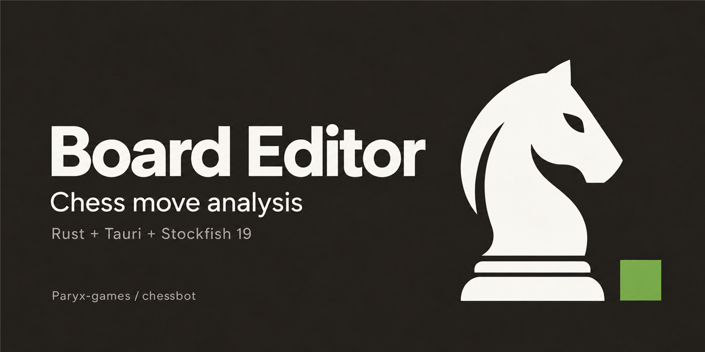

<a id="readme-top"></a>

<div align="center">
  <a href="https://github.com/Paryx-games/chessbot">
    
  </a>

  <h3 align="center">Board Editor</h3>

  <p align="center">
    My Windows chess board editor using Tauri, Rust, and Stockfish 19, with position editing, move analysis, and automated play.
    <br />
    <a href="#usage"><strong>Explore the app »</strong></a>
    <br />
    <br />
    <a href="https://github.com/Paryx-games/chessbot/releases/latest">Download</a>
    &middot;
    <a href="https://github.com/Paryx-games/chessbot/issues/new?template=bug_report.yml">Report Bug</a>
    &middot;
    <a href="https://github.com/Paryx-games/chessbot/issues/new?template=feature_request.yml">Request Feature</a>
  </p>

  <p align="center">
    <a href="https://github.com/Paryx-games/chessbot/actions/workflows/ci.yml">
      
    </a>
    <a href="https://github.com/Paryx-games/chessbot/actions/workflows/release.yml">
      
    </a>
    <a href="https://github.com/Paryx-games/chessbot/releases/latest">
      
    </a>
    
    
    
    
    
  </p>
</div>

<details>
  <summary>Table of Contents</summary>
  <ol>
    <li><a href="#showcase-image">Showcase Image</a></li>
    <li><a href="#about-the-project">About The Project</a></li>
    <li><a href="#performance">Performance</a></li>
    <li>
      <a href="#download">Download</a>
      <ul>
        <li><a href="#system-requirements">System Requirements</a></li>
      </ul>
    </li>
    <li><a href="#features">Features</a></li>
    <li><a href="#usage">Usage</a></li>
    <li><a href="#credits">Credits</a></li>
    <li><a href="#support-the-project">Support the Project</a></li>
    <li>
      <a href="#building-from-source">Building From Source</a>
      <ul>
        <li><a href="#prerequisites">Prerequisites</a></li>
        <li><a href="#build">Build</a></li>
      </ul>
    </li>
    <li><a href="#benchmarking">Benchmarking</a></li>
    <li><a href="#development-commands">Development Commands</a></li>
    <li><a href="#reporting-issues--requesting-features">Reporting Issues &amp; Requesting Features</a></li>
    <li><a href="#contributing">Contributing</a></li>
    <li><a href="#license">License</a></li>
  </ol>
</details>

## Showcase image



## About The Project

I built Board Editor as a Windows chess position editor using Rust, Tauri, and native Stockfish. Set up a board, analyse moves, and watch the engine play one or both sides.

The interface lives in `frontend/`, with the Rust backend and desktop configuration in `src-tauri/`. I use plain HTML, CSS, and JavaScript for the board and controls, and keep engine execution and game-status checks in Rust.

**[Read the usage section](#usage)** for the board controls, analysis settings, and automated play.

### Built With

- [Rust](https://www.rust-lang.org/)
- [Tauri](https://tauri.app/)
- [Stockfish 19](https://github.com/official-stockfish/Stockfish/releases/tag/sf_19)
- HTML, CSS, and JavaScript

<p align="right">(<a href="#readme-top">back to top</a>)</p>

## Performance

I run Stockfish as a separate native process so its search doesn't block the board controls. Search time and CPU usage depend on the position, selected depth, and hardware. Higher depths can take much longer for a single move; see [Benchmarking](#benchmarking) to test the bundled engine on a particular machine.

## Download

Download my [latest release](https://github.com/Paryx-games/chessbot/releases/latest). For alpha, beta, release-candidate, and earlier versions, browse [all releases](https://github.com/Paryx-games/chessbot/releases).

See [CHANGELOG.md](CHANGELOG.md) for what's changed. Downloads will appear once I publish the first release.

My release workflow produces two app downloads:

- **Installer** - `chessbot-vX.Y.Z-windows-x64-setup.exe`. Installs Board Editor with Stockfish and the license/source resources. **Recommended for most users.**
- **Portable ZIP** - `chessbot-vX.Y.Z-windows-x64-portable.zip`. Extract the whole archive and run `chess-stockfish.exe`. Keep `stockfish.exe` and the other files alongside it. Microsoft WebView2 Runtime must already be installed.

The installer can download WebView2 if it's missing, which requires internet access. Once the app and runtime are installed, I can edit positions and run analysis offline.

Release assets include `SHA256SUMS.txt` for the downloads and the corresponding Stockfish source archive. Compare a download with `Get-FileHash -Algorithm SHA256` when checking its integrity. GitHub provides the app's source archives automatically.

> [!TIP]
> **Keep the portable folder together.** Board Editor needs the bundled Stockfish executable and license/source resources. WebView2 may store browser data outside the extracted folder.

No Rust or Node.js installation is required to run either download. I use those tools for building the app and checking its code. My current builds are unsigned.

### System Requirements

- Windows x64
- Microsoft WebView2 Runtime
- Enough screen space for a 1310 × 925 content area, plus the title bar and window borders

<p align="right">(<a href="#readme-top">back to top</a>)</p>

## Features

- **Position Editing** - Drag pieces from the tray, move them around, or drop them off the board to remove them
- **FEN Positions** - Import a position and copy the current board as FEN
- **Move Analysis** - Show Stockfish's suggested move, principal variation, and evaluation
- **Vertical Evaluation Bar** - Read the position's evaluation beside the board, with orientation following the board flip
- **Search Depth** - Choose 6, 8, 12, 16, or 24, or use a Custom slider from 1 to 48
- **Automatic Moves** - Let Stockfish apply its suggestions for one side or play both sides
- **Game Status** - Show check, checkmate, stalemate, and supported draw conditions, with a red square around a checked king
- **Board Appearance** - Flip the board and choose from four colour themes

I keep board editing unrestricted, so pieces can be placed freely. Rust validates the resulting position before analysis. Manual promotion defaults to a queen; engine moves preserve Stockfish's selected promotion piece.

> [!IMPORTANT]
> Draw detection uses the position and move history available in the app. Loading a FEN or editing the position resets repetition history. I label threefold repetition and fifty-move draws as claimable, and stop automation for those conditions too.
>
> Before contributing, please read my [commit guide](CONVENTIONAL_COMMITS.md) and [contributing guide](CONTRIBUTING.md). For engine or move-handling changes, include example FENs and explain how cancellation and game status were checked.

<p align="right">(<a href="#readme-top">back to top</a>)</p>

## Usage

1. **First launch** - Start with the normal opening position, or choose Clear to create a position from scratch.
2. **Edit the board** - Drag pieces from the tray, drag them off the board to remove them, or right-click a square to clear it.
3. **Set the position** - Select the side to move or paste a FEN into the position field.
4. **Analyse** - Choose White or Black under Stockfish plays, then select a depth. I use 12 as the default; Custom reveals the 1–48 slider.
5. **Automate** - Enable Auto-play moves to apply suggestions, or Both sides to watch Stockfish play itself.
6. **Display and share** - Flip the board, select a theme, and use Copy FEN to share the current position.

The game-status box identifies check, checkmate, stalemate, insufficient material, repetition, and move-count draws. I stop automatic play at terminal positions, claimable draws, or after 200 plies. Changing the position or depth cancels the old search.

> [!NOTE]
> Depths above 24 can take a long time for a single move. The app shows a warning at those depths. I don't impose a fixed search time limit; changing the position or depth cancels the search.

<p align="right">(<a href="#readme-top">back to top</a>)</p>

## Credits

- [Stockfish](https://github.com/official-stockfish/Stockfish) - The native chess engine I use for move analysis
- [Tauri](https://github.com/tauri-apps/tauri) - The desktop application framework
- [shakmaty](https://github.com/niklasf/shakmaty) - Chess position validation and game-status rules in the Rust backend
- [serde](https://github.com/serde-rs/serde) - Data serialization between the Rust backend and UI

I've listed third-party license information in [THIRD_PARTY_NOTICES.md](THIRD_PARTY_NOTICES.md).

<p align="right">(<a href="#readme-top">back to top</a>)</p>

## Support the Project

If Board Editor is useful to you or you enjoy using it, you can support me on Ko-fi. Donations are optional, and I appreciate the support.

<a href="https://ko-fi.com/paryx">
  
</a>

<p align="right">(<a href="#readme-top">back to top</a>)</p>

## Building From Source

### Prerequisites

- [Rust](https://rustup.rs/) (stable, MSVC toolchain)
- [Node.js](https://nodejs.org/) for JavaScript and automation checks
- PowerShell 7 (`pwsh`)
- Windows x64
- Visual Studio Build Tools with Desktop development with C++ and a Windows SDK
- Microsoft WebView2 Runtime

### Build

```powershell
# Clone the repository
git clone https://github.com/Paryx-games/chessbot.git
cd chessbot

# Install the Tauri CLI
cargo install tauri-cli --version 2.11.2 --locked

# Fetch the pinned Stockfish executable and source resources
pwsh -NoProfile -ExecutionPolicy Bypass -File scripts/fetch-stockfish.ps1

# Build the production application and installer
cargo tauri build --ci --bundles nsis -- --locked
```

The executable is `src-tauri/target/release/chess-stockfish.exe`. The installer is under `src-tauri/target/release/bundle/nsis/`, normally `Board Editor_<version>_x64-setup.exe`. I use the Tauri CLI for distributable builds so the frontend, native sidecar, and resources are packaged together.

<p align="right">(<a href="#readme-top">back to top</a>)</p>

## Benchmarking

I can check Stockfish's search performance with its built-in benchmark. After fetching the sidecar, run this from the repository root:

```powershell
.\src-tauri\binaries\stockfish-x86_64-pc-windows-msvc.exe bench
```

This reports engine search statistics, including nodes searched and nodes per second. Results depend on the hardware and engine settings. It measures Stockfish rather than the desktop app's total CPU or memory usage.

<p align="right">(<a href="#readme-top">back to top</a>)</p>

## Development Commands

Run these commands from the repository root unless noted otherwise.

### Rust backend

```powershell
# Format the Rust code
cargo fmt --manifest-path src-tauri/Cargo.toml --all

# Check the backend
cargo check --manifest-path src-tauri/Cargo.toml --locked

# Run Rust and native sidecar tests
cargo test --manifest-path src-tauri/Cargo.toml --all-features --locked

# Run the strict CI lint configuration
cargo clippy --manifest-path src-tauri/Cargo.toml --all-targets --all-features --locked -- -D warnings
```

### Tauri and UI

I keep the UI in `frontend/` and the Rust backend, configuration, and installer resources in `src-tauri/`. The frontend loads directly without a separate build step.

```powershell
# Start the desktop app
cargo tauri dev

# Check JavaScript syntax
node --check frontend/app.js

# Check application version consistency
node scripts/check-version.cjs

# Test CI selection, reporting, and release packaging
node --test .github/scripts/*.test.cjs

# Build the optimized application and installer
cargo tauri build --ci --bundles nsis -- --locked

# Build a standalone debug application with the frontend embedded
cargo tauri build --debug --no-bundle
```

I use `assets/branding/icon.png` as the icon source and `src-tauri/icons/icon.ico` as the Windows app icon. The matching social image is `assets/branding/social-preview.png`; [branding instructions](assets/branding/README.md) explain how I regenerate icons and set the GitHub preview.

Stockfish is pinned to `sf_19`. My downloader verifies the binary archive's SHA-256 digest and prepares the matching source and license resources. Keep those files with the app when packaging a portable build.

Windows locks running executables. Close an app built from the output directory before rebuilding it, or choose another output directory if a session needs to stay open.

> [!TIP]
> For quick feedback, I use `cargo check --manifest-path src-tauri/Cargo.toml --locked` and `node --check frontend/app.js`. I run the full checks before opening a PR or releasing a build.

> [!IMPORTANT]
> Read [.agents/instructions.md](.agents/instructions.md) before changing the app. I keep process execution in Rust and preserve free board editing, search cancellation, and sidecar cleanup. Follow [PR_CONVENTIONS.md](PR_CONVENTIONS.md) when opening a PR.

### Pull request validation

Run the same checks I use in CI before submitting a change:

```powershell
cargo fmt --manifest-path src-tauri/Cargo.toml --all -- --check
cargo test --manifest-path src-tauri/Cargo.toml --all-features --locked
cargo clippy --manifest-path src-tauri/Cargo.toml --all-targets --all-features --locked -- -D warnings
node --check frontend/app.js
node scripts/check-version.cjs
node --test .github/scripts/*.test.cjs
```

> [!NOTE]
> I use [Conventional Commits](CONVENTIONAL_COMMITS.md) for commit messages. Add user-visible changes to the Unreleased section of [CHANGELOG.md](CHANGELOG.md).

<p align="right">(<a href="#readme-top">back to top</a>)</p>

## Reporting Issues & Requesting Features

Found a bug or have an idea for Board Editor? Here's where I'd like it to go:

- **Bug report** - [Open a bug report](https://github.com/Paryx-games/chessbot/issues/new?template=bug_report.yml). Give me the app version, Windows version, FEN, depth, and steps to reproduce it.
- **Feature request** - [Open a feature request](https://github.com/Paryx-games/chessbot/issues/new?template=feature_request.yml). Tell me which editing or analysis workflow it would improve.
- **Security vulnerability** - Follow my private reporting instructions in [SECURITY.md](SECURITY.md).
- **Existing issues** - Check the [open issues](https://github.com/Paryx-games/chessbot/issues) first in case I've already got a report.

<p align="right">(<a href="#readme-top">back to top</a>)</p>

## Contributing

I welcome fixes, suggestions, and improvements that make the chess editor easier to use. Clear reproduction positions and focused changes make it easier for me to review a contribution.

If you'd like to help, fork the repository and open a pull request. You can also open a feature request first. Please read my [commit guide](CONVENTIONAL_COMMITS.md) and [contributing guide](CONTRIBUTING.md), and explain any changes to move handling, Stockfish execution, or packaging.

1. Fork the project.
2. Create a feature branch (`git checkout -b dev/short-feature-name`).
3. Commit the change (`git commit -m 'feat(board): add a board improvement'`).
4. Push the branch (`git push origin dev/short-feature-name`).
5. Open a pull request.

<p align="right">(<a href="#readme-top">back to top</a>)</p>

## License

I've licensed Board Editor under [GPL-3.0-or-later](LICENSE). Third-party components retain their own licenses; see [THIRD_PARTY_NOTICES.md](THIRD_PARTY_NOTICES.md).

<p align="right">(<a href="#readme-top">back to top</a>)</p>
